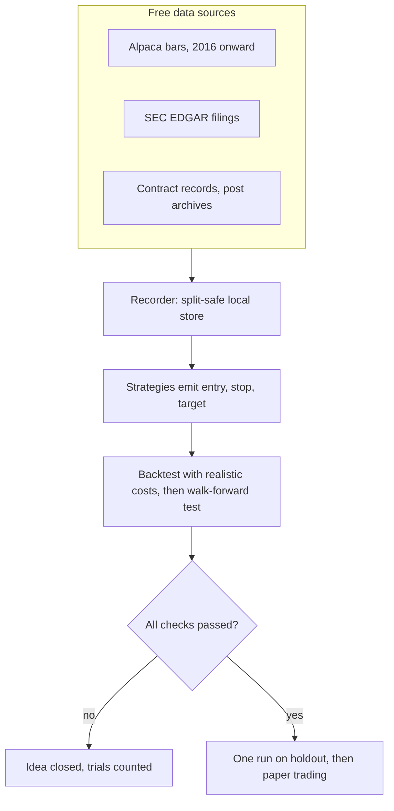
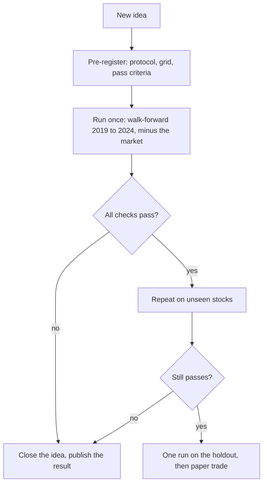
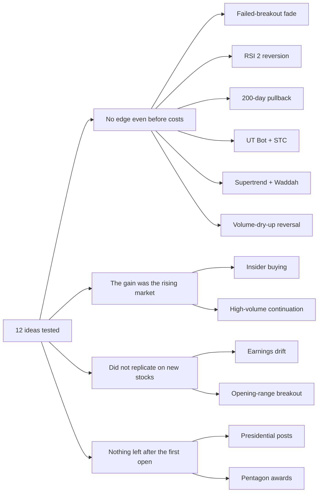

<div align="center">


# Sift

### Honest testing for trading ideas

A pre-registered research pipeline that tests short-term US stock strategies on free data,<br>
and catches the ideas that only look like they work.


**[Read the report (PDF)](docs/Trading-Research-Findings.pdf)** &nbsp;·&nbsp; [Findings](docs/findings.md) &nbsp;·&nbsp; [How it works](#how-it-works) &nbsp;·&nbsp; [All results](#all-results) &nbsp;·&nbsp; [Get started](#get-started)

</div>

---

## What is Sift?

**Why.** Trading strategies spread online because they are easy to describe and easy to believe: a bot that doubled a small
account overnight, two indicators with a high win rate, a screenshot of a good week. What is missing is a fair test. Two
traps make almost any idea look good: **selection luck** (try enough rules on one stretch of history and some will fit it by
chance) and **the market's own rise** (when stocks go up, almost any rule that buys makes money). Sift exists to find out
which ideas, if any, survive a test that is built to catch both, starting from $0 and using only free data.

**What.** Sift downloads market data, turns each idea into exact rules, simulates the trades with realistic costs, and judges
the result with checks designed to catch luck. The rule is simple: **no real money until an idea has proved itself on data it
was not tuned on.** The name is the method: put each idea on a sieve and see what stays behind.

**Result.** Twelve ideas were tested. None passed. Several looked like winners until the market's rise was subtracted, or until
they were repeated on stocks they had never seen. No money was traded.

<p align="center">
  
</p>

<sub>Dot = result after costs, line = 95% confidence interval, zero = no edge. Orange = after subtracting what simply holding the market earned. R = profit in units of the amount risked per trade.</sub>

## The twelve ideas and what happened

Each idea is a belief about how prices behave. The test asks: acting on that belief with fixed rules, would it have made money
after costs, and more than just holding the market?

| # | Idea | The belief, in plain words | Result | Verdict |
|:-:|---|---|---|---|
| 1 | Opening-range breakout | After the first minutes set a range, a close beyond it keeps going | +0.065R ±0.114 | ⚠️ Faint tilt that vanished on 50 fresh stocks (−0.046R) |
| 2 | Failed-breakout fade | A breakout that fails traps buyers and reverses | −0.000R ±0.042 | ❌ No edge |
| 3 | RSI(2) mean reversion | After a sharp two-day fall, a stock bounces within days | −0.026R ±0.021 | ❌ Significantly negative |
| 4 | 20/200-day pullback | In an uptrend, a dip to the 20-day average is a cheap entry | −0.032R ±0.028 | ❌ Significantly negative |
| 5 | Earnings drift | After an unusual earnings reaction, a stock keeps moving that way | +0.156R ±0.099 | ⚠️ 5 of 6 checks, then **+0.025R** on 250 unseen stocks |
| 6 | Insider buying | Executives buying with their own money know something | +0.028R ±0.078 | ⚠️ The gain was the market: **−0.079R** after subtracting it |
| 7 | Presidential posts | A post praising or attacking a company moves its stock | −0.05% ±0.60 per event | ❌ Nothing left after the first open |
| 8 | Pentagon contract awards | A big defence contract lifts the winner's stock | −0.10% ±0.27 per event | ❌ Nothing left after the first open |
| 9 | UT Bot + Schaff Trend Cycle | A video "bot": a trailing-stop flip confirmed by a cycle indicator | −0.038R ±0.006 | ❌ Clearly negative |
| 10 | Supertrend + Waddah Attar | A video "bot": a trend line agreeing with a momentum surge | −0.042R ±0.005 | ❌ Clearly negative |
| 11 | Volume-dry-up reversal | A weekly move on shrinking volume snaps back | −0.008R ±0.010 | ❌ No edge, even before costs |
| 12 | High-volume continuation | The highest volume in weeks starts an upward drift | +0.100R ±0.019 | ⚠️ 5 of 7 checks, then **−0.039R** after the market |
| – | 200-day trend filter on SPY | Holding the market only above its 200-day average is safer | 8.8% a year vs 12.8% | ⚖️ Worst drop −22% instead of −32%, at a price |

The last row is a side question, not a trading idea. Full plain-language explanations are in the [report](docs/findings.md#2-the-twelve-ideas-in-plain-words).

## How it works

<!-- diagram:pipeline -->

<!-- /diagram -->

1. **Data.** A recorder downloads free bars (Alpaca's free tier, back to 2016), SEC filings, government contract records and
   public post archives into a local store. Stock splits are applied when data is read.
2. **Strategies.** Each idea becomes exact rules that output signals: direction, entry, stop and a target at 1.5 times the risk.
3. **Backtest engine.** It replays history with realistic fills (next-bar open plus slippage, stops win ties, gaps fill at the open)
   and measures results in R, profit as a multiple of the amount risked.
4. **Statistics.** Walk-forward testing, a log of every configuration tried, a Deflated Sharpe check, a market-adjusted check and
   replication on unseen stocks.
5. **Paper trading.** A loop for a broker's paper account, built for the day an idea passes. None did.

**Tech stack:** Python 3.12+ with `uv`, pandas and Parquet for a split-safe bar store, Alpaca's free market-data tier, SEC EDGAR,
USAspending.gov, a SQLite trial registry, pytest, and Mermaid with pandoc/XeLaTeX for the report.

## How the tests stay honest

<!-- diagram:method -->

<!-- /diagram -->

- **Pre-registration:** protocol, parameter grid and pass criteria are committed *before* each run. The git history proves the order.
- **Walk-forward, out of sample:** parameters are chosen on earlier years and judged on the next (test years 2019 to 2024).
- **Untouched holdout:** data from 2025 onward is refused by the code unless an explicit flag is passed. It has not been read.
- **Every try is counted:** 298 configurations logged; the Deflated Sharpe Ratio asks whether a result survives that many attempts.
- **Realistic fills and costs**, a **market-adjusted check**, and **replication on stocks that played no part in choosing the rule.**

## What I learned

<!-- diagram:verdicts -->

<!-- /diagram -->

1. **Costs were not the main reason.** Several families had no edge even at zero cost.
2. **The market did the work.** Long-only rules were positive largely because stocks rose in 2019 to 2024.
3. **Replication is the strongest filter.** Lucky results on a few stocks did not survive fresh ones.
4. **Treat screenshots, reels and "I made X overnight" claims as hypotheses.** They deserve the same test, and most fail it.
5. **A clear "no" is a result.** It saved capital, and the method now makes the next question cheap to test.

Read the full write-up in the [report (PDF)](docs/Trading-Research-Findings.pdf) or [docs/findings.md](docs/findings.md).

## All results

| Milestone | Idea | Protocol (written first) | Result |
|---|---|---|---|
| M4 | Opening-range breakout, failed-breakout fade | [protocol](docs/m4-protocol.md) | [results](docs/m4-results.md) |
| M4b | Breakout on 50 fresh stocks | [protocol](docs/m4b-protocol.md) | [results](docs/m4b-results.md) |
| M6 | RSI(2) reversion, 20/200-day pullback | [protocol](docs/m6-swing-protocol.md) | [results](docs/m6-results.md) |
| M7 | Earnings-announcement drift | [protocol](docs/m7-events-protocol.md) | [results](docs/m7-results.md) |
| M8 | The same setting on 250 unseen stocks | [protocol](docs/m8-confirmation-protocol.md) | [results](docs/m8-results.md) |
| M9 | UT Bot + STC, Supertrend + Waddah | [protocol](docs/m9-indicators-protocol.md) | [results](docs/m9-results.md) |
| M10 | Insider buying, routine vs opportunistic | [protocol](docs/m10-insider-protocol.md) | [results](docs/m10-results.md) |
| M11 | Volume-dry-up reversal, high-volume continuation | [protocol](docs/m11-volume-protocol.md) | [results](docs/m11-volume-results.md) |
| M12 | Presidential posts, Pentagon awards (event studies) | [protocol](docs/m12-political-protocol.md) | [results](docs/m12-political-results.md) |
| M13 | 200-day trend filter on SPY | [protocol](docs/m13-trend-filter-protocol.md) | [results](docs/m13-trend-filter-results.md) |

M0 to M3 and M5 are infrastructure: decisions, a data-depth probe, the recorder, the backtest engine and a paper-trading loop
(plumbing only; nothing was run for evidence). A literature review that shaped M11 is in [docs/ideas/candle-strategies.md](docs/ideas/candle-strategies.md).

## Get started

```sh
uv sync
cp .env.example .env        # fill in the Alpaca paper keys; .env is gitignored
uv run pytest               # 212 tests
uv run python scripts/sweep.py --config config/sweeps/m10-insider.toml   # rerun one pre-registered sweep
uv run python scripts/build_report.py                                    # rebuild the PDF (needs pandoc + XeLaTeX)
```

```text
src/tp/          data store, backtest engines, strategies, statistics, paper loop, report builder
scripts/         command-line tools: recorder, sweeps, event studies, report builder
config/          universes and every sweep grid (frozen when committed)
docs/            protocols, results, the findings report and its Mermaid diagrams
tests/           the test suite
ops/launchd/     job templates (the nightly sync is parked, the paper loop is not installed)
```

## Reference

Details on the data layer, the backtest conventions and the paper-trading plumbing.

<details>
<summary><b>Setup</b></summary>

```sh
uv sync
cp .env.example .env        # then fill in the Alpaca paper keys; .env is gitignored
uv run pytest
```

</details>

<details>
<summary><b>Data and the nightly sync</b></summary>

Raw bars live in `data/bars/<feed>/<timeframe>/<symbol>/<utc year>.parquet` (gitignored). Bar timestamps are
the bar open, in UTC. Splits live in `data/corp_actions/splits.parquet`; prices are adjusted at read time so a
new split never invalidates stored history.

| Dataset | From | Why |
|---|---|---|
| `sip/1Min`, `sip/1Day` | 2016 | Consolidated tape. Backtest on this. Free tier, but the newest 15 minutes are withheld. |
| `iex/1Min` | 2020-07-27 | What a free real-time paper loop will see (about 4% of consolidated volume). Used to check that volume filters like RVOL still work on the live feed. |

```sh
uv run python -m tp.recorder                     # backfill + incremental sync (safe to re-run)
uv run python -m tp.recorder --symbols AAPL --specs sip:1Day
uv run python scripts/validate_bars.py           # integrity checks
uv run python scripts/probe_alpaca.py            # re-measure free-tier history depth
```

```python
from tp.bars import load_bars
df = load_bars("NVDA", feed="sip", timeframe="1Min", rth=True, resample="5min")  # split-adjusted by default
```

Coarser bars are derived from 1-minute bars (`resample="5min"`), not stored separately.

#### Daily schedule (parked)

`ops/launchd/com.tradingpipeline.recorder.plist` runs the recorder daily at 03:00 local time (CET, which is
21:00 ET, after the extended session and the SIP delay). If the Mac was asleep, launchd runs it on wake, and
the recorder catches up on anything missed. Log: `data/logs/recorder.log`.

**Currently parked** (unloaded; the installed copy is saved in `data/parked/`). To restart it, copy the plist from
`ops/launchd/` into `~/Library/LaunchAgents/` and run `launchctl bootstrap gui/$(id -u) ~/Library/LaunchAgents/com.tradingpipeline.recorder.plist`.
A 403 problem that made every nightly request fail (the fetch end time reached past the free tier's 15-minute
delay when the job ran after 20:30 ET) is fixed in `tp.recorder.fetch_end`.

```sh
launchctl print gui/$(id -u)/com.tradingpipeline.recorder      # status
launchctl kickstart gui/$(id -u)/com.tradingpipeline.recorder  # run now
# remove:
launchctl bootout gui/$(id -u)/com.tradingpipeline.recorder && rm ~/Library/LaunchAgents/com.tradingpipeline.recorder.plist
```

#### M1 findings (AAPL, 2026-11-05)

- SIP 1m/5m history reaches 2016 with 100% bar coverage at yearly anchor weeks, free.
- IEX starts 2020-07-27 and carries about 4% of consolidated volume. One sample week (Mar 2025) was missing a day.
- Free-tier live latency was not tested; the assumption is IEX real time and SIP delayed 15 minutes.
- Decision: backtest on SIP, run the free paper loop on IEX with price-only triggers, and validate volume filters on IEX data.

</details>

<details>
<summary><b>Backtesting conventions and overfitting guards</b></summary>

```sh
uv run python scripts/run_backtest.py --strategy orb --symbols AAPL,MSFT,NVDA --cost-sweep
uv run python scripts/run_backtest.py --strategy orb --set or_minutes=15 --set stop_mode=atr
```

A strategy turns bars into `Signal(side, entry_ref, stop, target)` on closed bars. `tp.backtest` then simulates
each signal and sizes the survivors. Conventions, chosen so a backtest cannot flatter the strategy:

- Entry is a market fill at the **next** bar's open plus slippage. Stop and target come from the signal bar's close, like a live bracket order.
- Stop exits pay slippage, and gaps through the stop fill at the open. Targets are limit orders that need price to trade through them.
- A bar touching both stop and target counts as a loss. Everything is flat by 15:55 ET.
- Slippage and trade-through are as-traded dollars, scaled by the split factor (bars are split-adjusted).
- Strategy quality is measured in R over every simulated trade. Portfolio results (return, drawdown, Sharpe) use the trades left after sizing (1% risk of compounding equity), the leverage cap and the position cap.

Overfitting guards:

- **Trial registry.** Every run is appended to `data/trials.sqlite`. The count per strategy feeds the Deflated Sharpe check.
- **Holdout.** Data from `config.HOLDOUT_START` (2025-01-01) is refused unless `--use-holdout` is passed, and such runs are flagged. Keep it for the final validation only.

Verification: the test suite (212 tests), plus an independent re-derivation of 300 random trades from raw bars with a separate loop (all matched).

#### Baseline result (plumbing check, not a finding)

Unfiltered 5-minute ORB on AAPL, MSFT and NVDA, 2016-2024: expectancy +0.008R +-0.025 (95% CI), profit factor 1.02,
so no edge after costs, as expected before any filter. Zero slippage gives +0.024R and 3 cents gives -0.024R, so
costs decide it. The first run (trial 1) is in the registry with a slippage-scaling bug that overstated
costs on split-adjusted prices; trial 2 is the corrected run.

</details>

<details>
<summary><b>Paper trading (plumbing only)</b></summary>

`tp.paper` runs the same strategy code as the backtest on live IEX bars and sends bracket orders to the Alpaca
**paper** account. No strategy has passed the protocol, so `config/paper/plumbing.toml` is a **machinery test**:
its trades are flagged `evidence = 0` and say nothing about any edge.

```sh
uv run python -m tp.paper --once      # one decision cycle on the current bar, then exit
uv run python -m tp.paper             # the full loop; DRY RUN by default (logs, sends nothing)
uv run python -m tp.paper --live      # sends orders to the paper account
uv run python scripts/paper_report.py # decisions, fills, slippage vs the backtest's assumption
touch data/KILL                       # kill switch: stops entries, flattens, exits (rm to re-arm)
```

How a cycle works: ~8 seconds after each 5-minute bar closes, it loads stored IEX history plus today's live bars,
runs `strategy.generate()` and keeps only signals decided on the bar that just closed. Each goes through guards
(kill file, daily loss cap, one position per symbol, max positions, max trades a day, no entries near flat time,
skip a stock for 20 days after a split), then sizing (fixed fraction of equity at the stop, leverage cap), then a
market order with an attached take-profit and stop-loss. Client order ids are deterministic, so a restart cannot
double-submit. At 15:55 ET it cancels working orders and closes positions. Everything goes to `data/paper.sqlite`.

What was verified, not just unit-tested:

- Replaying 30 real sessions on 5 symbols bar by bar (`scripts/paper_replay_check.py`): 135 signals, 0 differences from the backtest.
- Alpaca accepts our bracket format (`scripts/paper_smoke_order.py`, a limit order that cannot fill, placed and cancelled).
- A real 1-share paper round trip through the runner: fill, attached legs, flatten, and the exit recorded as `flat`.

Scheduling is a template, not installed: `ops/launchd/com.tradingpipeline.paper.plist` starts the loop on weekdays
at 14:00 local time (always before the open) and exits on holidays.

Free-feed caveat: live bars are IEX, which has gaps on quieter names (see the validator results). Names such as
AVGO, NFLX and GOOGL would miss bars; the live universe should be restricted to well-covered tickers.

</details>

---

<sub>**Disclaimer.** A personal research project, not investment advice. It recommends no security or strategy, and no real money was traded.
Findings apply only to the data, period (2016 to 2024), universes and rules described. Created in [T3 Code](https://t3.codes); code, analysis and
drafting were done with an AI coding assistant, and every number comes from results recorded in this repository.</sub>
