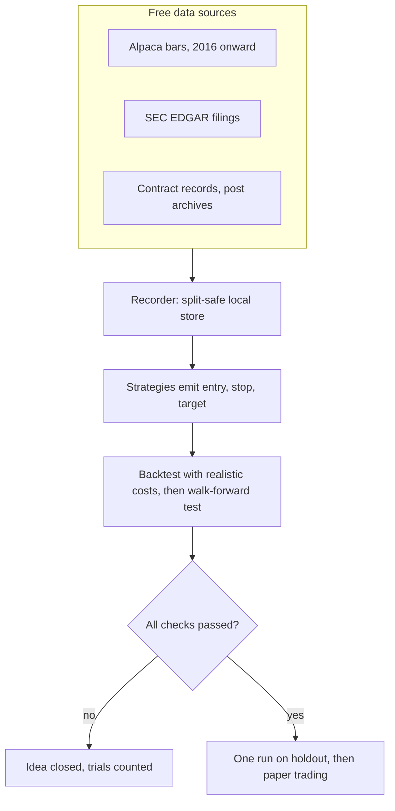
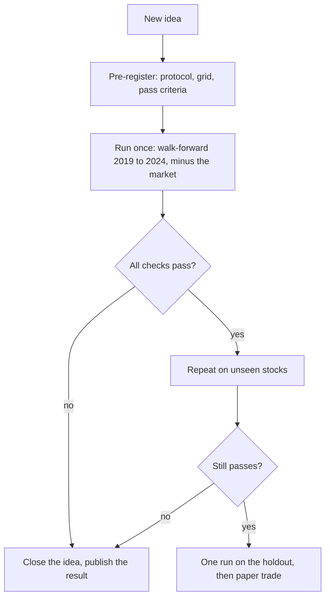
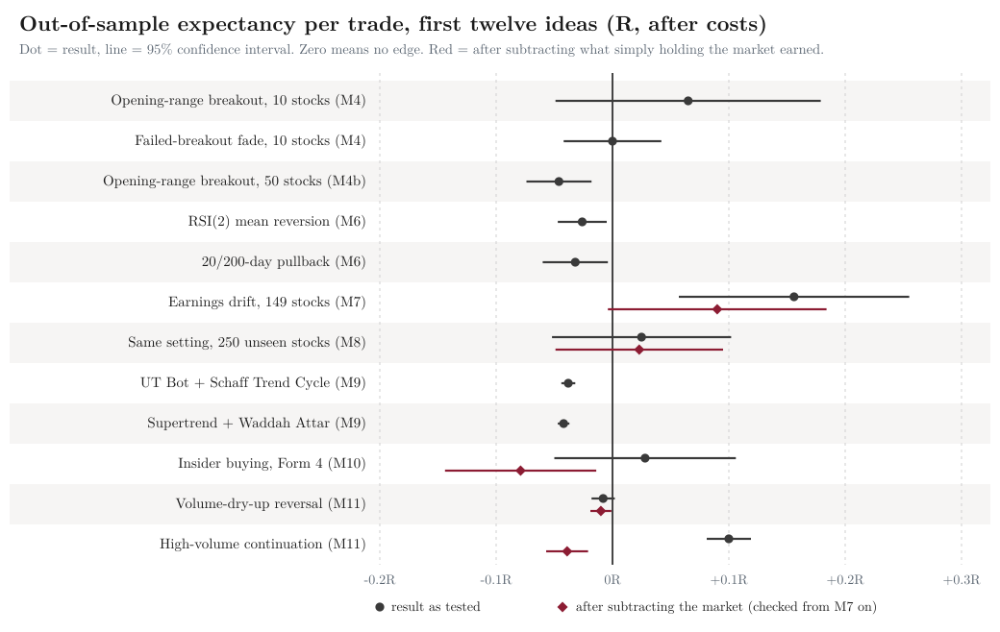
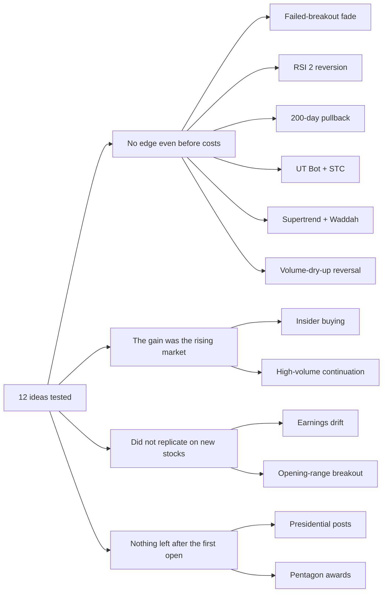

# Sift: twelve trading ideas, tested honestly on free data

**A pre-registered negative-results report on short-term US stock strategies**

Report date: 6 November 2026. Status: complete for the free-data scope described below. Data after 2024 has never been
analysed (see the holdout rule in section 3).

A typeset PDF of this report is in [Trading-Research-Findings.pdf](Trading-Research-Findings.pdf).

## Abstract

Online trading videos and social posts are full of strategies that "work". I wanted to know whether any of them survive a
fair test, starting from $0 and using only free data, so I built **Sift**: a research pipeline that downloads market data,
turns each trading idea into precise rules, simulates them with realistic costs, and judges them with checks designed to
catch luck. Over ten test milestones I tested twelve ideas, from opening-range breakouts and RSI reversion to earnings
drift, insider buying, volume signals, indicator bots popular in online videos, presidential social-media posts and
Pentagon contract awards. Every test was written down and committed before it was run, scored out of sample, and
charged for the number of tries it took to find it.

**None of the twelve ideas met all of its pre-registered criteria.** Several looked promising until the market's own
rise was subtracted or until the idea was repeated on stocks it had never seen. No money was traded, and no idea was
promoted to paper trading for evidence. The useful output is not a strategy; it is a method, and a short list of ways
that backtests flatter themselves.

> **The result in one line:** twelve ideas tested, none passed. When something looked like an edge, it was
> usually the market rising or luck that did not repeat on new stocks. No money was traded.

## 1. About the project: why and how

### Why it exists

Strategies spread online because they are easy to describe and easy to believe: a bot that doubled a small account
overnight, a pair of indicators with a high win rate, a screenshot of a good week. What is missing is a fair test. Two
traps make almost any idea look good:

- **Selection luck.** Try enough rules on one stretch of history and some will fit it by chance. This is called
  overfitting, or data-snooping, and the best-looking result of many tries is the one most likely to be luck.
- **The market's own rise.** In a period when stocks go up, almost any rule that buys will make money. That is not skill.

The goal was therefore twofold: build a pipeline that could find a short-term edge in US stocks, and make it hard for the
pipeline to fool its builder. The rule was: **no real money until an idea has proved itself on data it was not tuned on.**
Starting capital is $0, so everything uses free data and paper trading. The name, Sift, is the method: put each idea on a
sieve and see what stays behind. So far, mostly chaff.

### How it works

Sift has five parts, in the order data moves through them:

1. **Data.** A recorder downloads free market data (Alpaca's free tier gives consolidated-tape bars back to 2016), SEC
   filings, government contract records and public archives of posts, and stores them locally. Stock splits are applied
   when data is read, so a new split never corrupts history.
2. **Strategies.** Each idea is turned into exact rules that output trade signals: a direction, an entry, a stop-loss and a
   profit target, with the target fixed at 1.5 times the risk.
3. **Backtest engine.** It replays history trade by trade with realistic conventions: orders fill at the next bar's open plus
   slippage, a stop wins when a bar touches both stop and target, and gaps fill at the open. Results are measured in R, the
   profit as a multiple of the amount risked.
4. **Statistics.** Parameters are chosen on earlier years only and judged on later ones (walk-forward). Every configuration
   tried is logged, and a Deflated Sharpe check asks whether a result survives that many attempts. The market is subtracted,
   and promising results must repeat on stocks the rule never saw.
5. **Paper trading.** A loop that places orders on a broker's paper account was built and tested for plumbing, ready for the day an
   idea passes. None did, so nothing was ever run for evidence.

<!-- diagram:pipeline -->

<!-- /diagram -->

*Figure 1. The pipeline. Data flows from free sources through a split-safe store into strategies and a cost-aware backtest; only an idea that passes every check reaches the holdout, and only after that paper trading.*

The work was organised as one **milestone per idea**. For each, a protocol (the exact rules, the parameter grid and the pass
criteria) was written and committed to version control first; the test was then run once, and the result was recorded
whatever it showed. The commit history therefore proves the order. The code, the analysis and the drafting were done with an
AI coding assistant; the decisions, and every number in this report, trace back to results recorded in the repository.

### Constraints fixed at the start

- US stocks, short-term horizons (minutes to a few weeks), a fixed 1:1.5 risk-to-reward bracket on trades.
- Start with $0 of capital. Free data only: Alpaca's free tier (consolidated-tape bars from 2016, 15 minutes delayed),
  SEC EDGAR filings, USAspending.gov, public archives of presidential posts.
- Universe chosen by a fixed rule (median dollar volume in Q1 2016), never by hand: 10 large caps, then 50, 150 and 250
  further stocks (about 410 in total).

## 2. The twelve ideas, in plain words

Each idea is a belief about how prices behave. A test asks one question: if I had acted on that belief with fixed rules, would
I have made money after costs, and was that more than just holding the market? The ideas came from four places: classic
day-trading lore (ideas 1 to 4), academic research (5, 6, 11 and 12), indicator "bots" shown in online videos (9 and 10), and
the intuition that politics moves stocks (7 and 8).

### Short-term price patterns (minutes to hours, 5-minute bars)

1. **Opening-range breakout.** *The belief:* the first minutes of the trading day set a range, and when price closes beyond it,
   the move tends to continue. *The test:* trade in the direction of the break with a stop and a target at 1.5 times the
   risk, and close the trade by the end of the day. Optional filters were unusual volume, an overnight gap and the market's
   trend. Tried on 10 large stocks, then on 50 fresh ones.
2. **Failed-breakout fade.** *The belief:* a breakout that fails, with price closing back inside the range, traps the traders
   who bought it and reverses. *The test:* bet against the failed move, with the stop just beyond its extreme.

### Daily swing trades (days to weeks, daily bars)

3. **RSI(2) mean reversion.** *The belief:* after a sharp two-day fall a stock tends to bounce within days, and to fall back
   after a sharp rise. *The test:* buy when the 2-day RSI, a gauge of very short-term momentum, is extremely low and sell
   short when it is extremely high, optionally only in the direction of the 200-day trend.
4. **20/200-day pullback.** *The belief:* in an established uptrend, a dip back to the 20-day average is a chance to buy
   cheaply, and the reverse in a downtrend. *The test:* trade the first close back to the 20-day average while the
   20-day and 200-day averages agree on the trend.

### Events and news (daily bars)

5. **Earnings drift.** *The belief:* when a company reports results and its stock jumps or falls by an unusual amount, it keeps
   moving the same way for days or weeks. *The test:* take the timing from the exact moment of the SEC filing of each
   earnings release, measure the market-adjusted reaction in multiples of the stock's normal daily range, and follow (or
   fade) reactions of one to three ranges.
6. **Insider buying.** *The belief:* when company officers and directors buy shares with their own money they may know something
   the market does not, especially if the purchase is out of character ("opportunistic") rather than a habit ("routine").
   *The test:* trade clusters of purchases at the open after the public SEC filing, with the routine and opportunistic split
   from an academic paper by Cohen, Malloy and Pomorski.
7. **Presidential posts.** *The belief:* when the US president praises or attacks a listed company on social media, its stock
   moves, and a slower trader can still profit. *The test:* find posts that name a company (tweets 2016 to 2018, Truth Social
   2022 to 2024), take their tone from fixed word lists, enter at the first open after the post, hold five sessions.
8. **Pentagon contract awards.** *The belief:* a large defence contract lifts the stock of the winner. *The test:* use awards of
   $100 million or more to seven listed contractors from USAspending.gov, buy at the open two sessions after the award
   date and hold five sessions.

### Indicator bots popular in online videos (5-minute bars)

9. **UT Bot + Schaff Trend Cycle.** *The belief:* a trailing-stop indicator (UT Bot) flipping direction marks the start of a
   trend, and a second indicator (Schaff Trend Cycle) confirms it. *The test:* the common open-source definitions, 18 settings,
   including the video's asymmetric setup with different long and short parameters.
10. **Supertrend + Waddah Attar Explosion.** *The belief:* a trend line (Supertrend) agreeing with a momentum-surge indicator
    (Waddah Attar) marks high-quality entries, optionally only when the market is trending (ADX or Choppiness filter).
    *The test:* 12 settings, with the stop distance used in the video.

### Volume (daily bars)

11. **Volume-dry-up reversal.** *The belief:* a stock that fell (or rose) against the market over a week on shrinking volume was
    pushed by impatient traders rather than news, and tends to snap back. *The test:* trade against such moves of two to
    three daily ranges, with and without the volume condition.
12. **High-volume continuation.** *The belief:* a stock whose volume is the highest in weeks is receiving new attention and tends
    to drift upward over the following weeks. *The test:* buy on the highest-volume day of the last 20 or 50 sessions, long only.

One more test is a side question, not an idea (section 6): whether a 200-day trend filter makes simply holding the market
safer.

## 3. How the tests were kept honest

Most backtests that look good are noise that was selected. The framework was built to make that hard: Figure 2 shows the
method applied to every idea, and the table lists its safeguards.

| Safeguard | What it does |
|----------|----------------------------------|
| **Pre-registration** | For each test the protocol, parameter grid and pass criteria were committed to version control before the run. The commit history shows the order, so it cannot be quietly changed afterwards. |
| **Walk-forward, out of sample** | Parameters are chosen on earlier years only and judged on the next. Test years were 2019 to 2024. |
| **Untouched holdout** | Data from 2025 onward is kept for a single final run, and only for an idea that has already passed everything. The code refuses to read it without an explicit flag. No analysis has read it. |
| **Trial counting and Deflated Sharpe** | Every configuration tried is logged (298 in total). The Deflated Sharpe Ratio ([Bailey and Lopez de Prado](https://papers.ssrn.com/abstract=2460551)) asks whether a result still stands after paying for the number of attempts. |
| **Realistic fills and costs** | Next-bar fills, stops assumed hit first when a bar is ambiguous, gaps filled at the open, per-share slippage on market fills, limit targets that must trade through to fill, stock splits handled at read time, one open trade per symbol. A stress test doubles costs. |
| **Market-adjusted check** | Added after earnings drift: each trade's result minus what holding SPY the same way over the same dates would have earned. |
| **Replication on unseen stocks** | A single frozen setting is run once on stocks that took no part in choosing it. |

**Pass criteria (all must hold):** at least 300 out-of-sample trades; the 95% interval of expectancy above zero; Deflated
Sharpe at least 0.95; positive in at least 4 of 6 test years; still positive at double costs; at least 70% of
neighbouring parameter settings positive; and, from M8 on, a market-adjusted interval above zero. A test with too few
trades is "inconclusive", not a pass.

A note on units: **R** is profit measured in the amount risked on the trade. +0.1R means the average trade made 10% of
what it risked, after costs.

<!-- diagram:method -->

<!-- /diagram -->

*Figure 2. The method applied to every idea. Failing at any gate closes the idea and the result is published either way.*

## 4. Results

The table gives each idea's out-of-sample result and how many of its pre-registered checks it passed; Figure 3 shows the
same results as a picture, with their 95% intervals.

| Milestone | Idea | Data | Out-of-sample result (95% interval) | Checks passed |
|--------|-------------------------|--------------------|--------------------|--------|
| M4 | Opening-range breakout | 10 large caps, 5-min bars | +0.065R +-0.114 | 3 of 6 |
| M4 | Failed-breakout fade | same | -0.000R +-0.042 | 1 of 6 |
| M4b | Opening-range breakout | 50 fresh stocks | -0.046R +-0.028 | 1 of 6 |
| M6 | RSI(2) mean reversion | 50 stocks, daily | -0.026R +-0.021 | 1 of 6 |
| M6 | 20/200-day pullback | 50 stocks, daily | -0.032R +-0.028 | 1 of 6 |
| M7 | Earnings drift (SEC filing times) | 149 stocks, daily | +0.156R +-0.099 | 5 of 6 |
| M8 | M7's frozen setting, replicated | 250 unseen stocks | +0.025R +-0.077 | 2 of 7 |
| M9 | UT Bot + Schaff Trend Cycle | 50 stocks, 5-min | -0.038R +-0.006 | 1 of 6 |
| M9 | Supertrend + Waddah Attar | 50 stocks, 5-min | -0.042R +-0.005 | 1 of 6 |
| M10 | Insider buying (SEC Form 4) | 407 stocks, daily | +0.028R +-0.078 | 3 of 7 |
| M11 | Volume-dry-up reversal | 409 stocks, daily | -0.008R +-0.010 | 1 of 7 |
| M11 | High-volume continuation | 409 stocks, daily | +0.100R +-0.019 | 5 of 7 |
| M12 | Presidential posts naming a listed company | 133 events | -0.05% +-0.60 per event | 1 of 4 |
| M12 | Large Pentagon awards to listed primes | 933 events | -0.10% +-0.27 per event | 1 of 4 |



*Figure 3. Out-of-sample result per trade, in R (profit measured in units of the amount risked). Zero means no edge.
Blue: as tested. Orange: after subtracting what simply holding the market earned over the same dates, a check added
from M7 on. Lines are 95% confidence intervals.*

M12 is an event study (average market-adjusted return over five sessions, net of 10 basis points), not a strategy sweep,
so it has its own four criteria. "M4" and "M4b" are the ten-stock and fifty-stock runs of the same breakout grid.

Details, protocols and per-year numbers for each row are in `docs/m*-protocol.md` and `docs/m*-results.md`.

## 5. What kept recurring

<!-- diagram:verdicts -->

<!-- /diagram -->

*Figure 4. Why each idea failed, by main reason. Several had more than one: the breakout, for example, also showed a faint edge on 10 stocks that vanished on 50.*

**Costs were not the explanation.** The first guess was that a one-cent spread against tight five-minute stops ate a
small edge. A zero-cost diagnostic showed otherwise: breakouts were -0.020R +-0.028 before costs and volume reversal
+0.006R +-0.010. There was no gross edge to eat, so cheaper execution would not have rescued these ideas.

**The market did the work.** The long-only families look strongest in 2019 to 2024, a period in which US stocks rose. The
market-adjusted check changed the picture:

| Idea | As tested | After subtracting the market |
|---|---|---|
| Earnings drift (M7) | +0.156R | +0.090R +-0.094 |
| Insider buying (M10) | +0.028R | -0.079R +-0.065 |
| High-volume continuation (M11) | +0.100R | -0.039R +-0.018 |

All 16 volume-spike configurations were positive as tested, and they still failed. A related effect: the stock universe is
made of companies that were liquid in 2016 and are still listed today. Survivors make long positions look better and short
positions worse (in M6 longs were near zero and shorts clearly negative).

**Lucky results did not replicate.** The ten-stock breakout test (+0.065R) turned into -0.046R on fifty fresh stocks, with
all 54 configurations negative. Earnings drift passed five of six checks and then fell to +0.025R on 250 unseen stocks.
The Deflated Sharpe check had flagged the first of these in advance; replication confirmed it.

**Several attractive stories went nowhere.** Distinguishing routine from opportunistic insider trades follows a well-known
paper ([Cohen, Malloy and Pomorski, 2012](https://econpapers.repec.org/RePEc:bla:jfinan:v:67:y:2012:i:3:p:1009-1043));
in our large and mid-cap universe there were too few opportunistic buys to test the split. Presidential posts: published
work finds same-day reactions to tweets about firms
([Ajjoub, Walker and Zhao](https://econpapers.repec.org/RePEc:eme:ijmfpp:ijmf-02-2020-0068)), but starting at the next
open, as a slower trader must, nothing was left.

## 6. A side question: does a trend filter make holding the market safer? (M13)

Since the market kept beating the rules, I tested the simplest allocation rule: hold SPY while it is above its 200-day
average, otherwise hold cash. One parameter, fixed in advance, 2017 to 2024:

| | Buy and hold | 200-day filter |
|---|---|---|
| Return per year | 12.8% | 8.8% |
| Worst drawdown | -32.4% | -21.8% |
| Sharpe (risk-adjusted, no cash yield) | 0.78 | 0.75 |

It reduced the worst falls (2020: -19% instead of -32%; 2022: -17% instead of -27%) but missed the rebounds, and 18
of its 26 in-and-out trades lost money. It passed two of three pre-registered checks and failed the return one by
about 4 points a year. Eight years and two crashes are a short sample, and this is research, not advice: how large a fall
a holder can sit through matters more than these figures.

## 7. What this does not show

Absence of evidence in these tests is not proof that no edge exists. The scope was narrow:

- **Free data and daily or five-minute bars.** I could not test the first seconds and minutes after news, where fast
  traders operate, nor order-book or options data, nor paid datasets (earnings estimates, short interest, intraday news).
- **Large and mid caps only.** Several published effects are strongest in small stocks. I could not test them honestly
  because free price history omits delisted companies, which biases any such result upward.
- **One regime.** 2016 to 2024 is one stretch of one market, dominated by a rise. The holdout (2025 onward) was kept unread
  for a final run that no idea earned.
- **Survivor and hindsight bias.** The universe is stocks listed today. This was disclosed in each protocol and is why the
  market-adjusted check matters.
- **Clustering.** Events bunch in market selloffs, so confidence intervals are somewhat optimistic about independence.
- **Backtests are not live trading.** Slippage in fast markets, rejected orders and partial fills are modelled
  approximately. A paper-trading loop was built and tested against a broker's paper account for plumbing only; nothing was
  run for evidence.

## 8. Summary of findings

- **No idea passed.** Of twelve, the closest were earnings drift (5 of 6 checks, then it failed to replicate on 250
  unseen stocks) and a volume-spike rule (5 of 7 checks, then it turned negative after subtracting the market).
- **When it looked like an edge, it was mostly the market.** Long-only rules were positive in 2019 to 2024 largely
  because stocks rose. Insider buying went from +0.028R to -0.079R, and volume spikes from +0.100R to -0.039R, once the
  market was subtracted.
- **Costs were not the main reason.** The price-pattern families had no edge even at zero cost (for example breakouts at
  -0.020R, volume reversal at +0.006R, both consistent with zero).
- **Replication was the strongest filter.** A faint breakout result on 10 stocks (+0.065R) became -0.046R on 50 fresh
  ones. Earnings drift (+0.156R) became +0.025R on 250 unseen stocks.
- **Precision was high, so the negatives are real.** Some tests had around 100,000 trades with intervals of about
  +-0.005R. These are measured zeros and small negatives, not "not enough data".
- **A side question gave a trade-off, not a free lunch.** A 200-day trend filter on SPY cut the worst drawdown from -32% to
  -22% but cost about 4 points a year of return.

## 9. Takeaways

1. **Write the rules down before you look.** Commit them. It removes the most common way to fool yourself.
2. **Count your tries.** The best of many looks good by luck; deflate for it.
3. **Subtract the market.** In a rising period a long-only rule needs to beat holding, not zero.
4. **Replicate on stocks that took no part in choosing the rule.** It was the strongest filter here.
5. **Ask whether there is a gross edge before blaming costs.**
6. **Treat screenshots, reels and "I made X overnight" posts as hypotheses.** They are one run, picked after the fact, and
   rarely come with losing runs or costs. They deserve the same test as anything else, and most will fail it.
7. **A clear "no" is a result.** It saved capital, and the method now makes the next question cheap to test.

## 10. Reproduce it

Everything is in the project repository: code, each protocol (committed before its run), each result write-up and the tests
(212 passing). Data is not redistributed; the scripts fetch it from the free sources above.

```sh
uv sync
uv run pytest
uv run python scripts/sweep.py --config config/sweeps/m10-insider.toml
```

The last command reruns one pre-registered sweep (insider buying).

Start with `README.md`, then `docs/m4-protocol.md` for the method and `docs/m*-results.md` for each result.

## 11. Disclosures

This is a personal research project. It is not investment advice and recommends no security or strategy. No real money was
traded. The code, analysis and drafting were done with an AI coding assistant (Claude Code); every number in this report is
taken from results recorded in the repository, and the protocols' commit order is the evidence of what was decided when.

## References

- Bailey, D. and Lopez de Prado, M. (2014), [The Deflated Sharpe Ratio](https://papers.ssrn.com/abstract=2460551).
- Cohen, L., Malloy, C. and Pomorski, L. (2012), Decoding Inside Information, Journal of Finance 67(3),
  [record](https://econpapers.repec.org/RePEc:bla:jfinan:v:67:y:2012:i:3:p:1009-1043).
- Ajjoub, C., Walker, T. and Zhao, Y., Social media posts and stock returns: The Trump factor, International Journal of
  Managerial Finance, [record](https://econpapers.repec.org/RePEc:eme:ijmfpp:ijmf-02-2020-0068).
- Martineau, C. (2022), Rest in Peace Post-Earnings Announcement Drift, Critical Finance Review 11(3-4),
  [record](https://econpapers.repec.org/RePEc:now:jnlcfr:104.00000122): the drift has faded outside the smallest stocks
  (later work disputes this).
